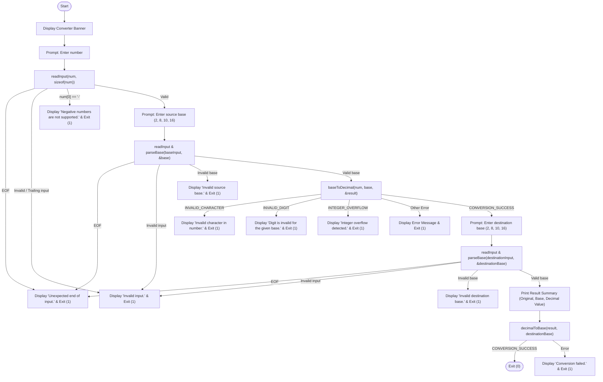
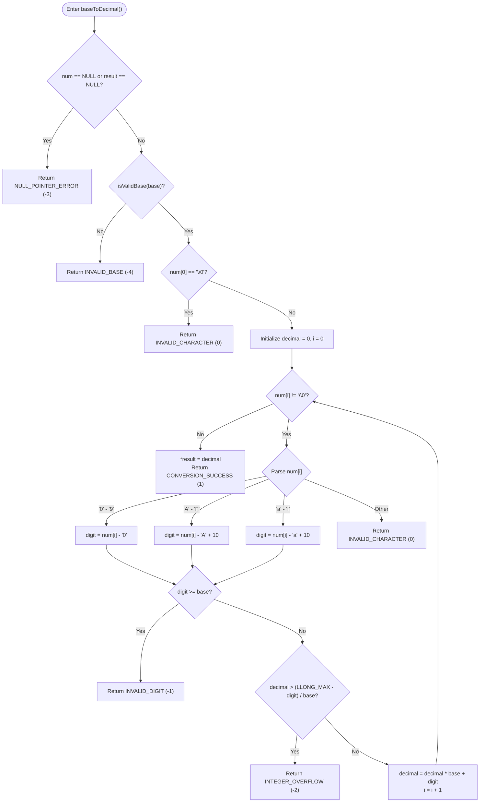
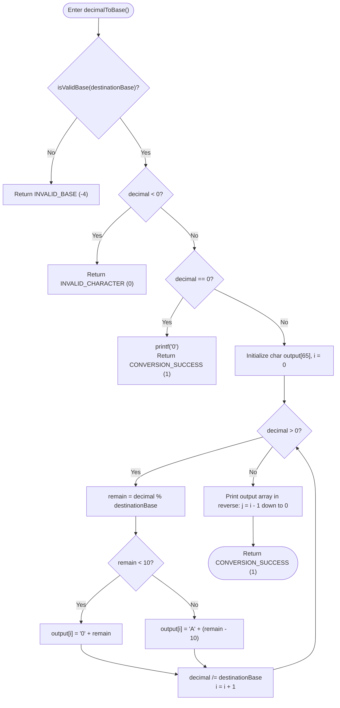

# 🔢 Number System Converter

[](https://en.wikipedia.org/wiki/C11_(C_language_standard))

A command-line Number System Converter written in standard C, featuring reusable conversion functions, input validation, and integer overflow protection. The program converts numbers between **Binary (Base 2)**, **Octal (Base 8)**, **Decimal (Base 10)**, and **Hexadecimal (Base 16)**.

---

## 📑 Table of Contents

- [Features](#features)
- [Supported Number Systems](#supported-number-systems)
- [Conversion Architecture](#conversion-architecture)
- [System Flow Diagrams](#system-flow-diagrams)
  - [1. Program Execution Flow](#1-program-execution-flow)
  - [2. Base-to-Decimal Conversion (`baseToDecimal`)](#2-base-to-decimal-conversion-basetodecimal)
  - [3. Decimal-to-Base Conversion (`decimalToBase`)](#3-decimal-to-base-conversion-decimaltobase)
- [Input Validation & Error Handling](#input-validation--error-handling)
- [Status Codes](#status-codes)
- [Limitations](#limitations)
- [Project Structure](#project-structure)
- [Compilation & Execution](#compilation--execution)
- [Sample Usage](#sample-usage)
- [Testing](#testing)
- [Contributing](#contributing)
- [License](#license)

---

## 🚀 Features

- **Multi-Base Conversions:** Converts between any combination of supported bases ($2, 8, 10, 16$).
- **Intermediate Decimal Representation:** Uses a two-stage conversion model with standard positional notation.
- **Integer Overflow Protection:** Employs pre-computation overflow checks using `LLONG_MAX` from `<limits.h>` before performing multiplication.
- **Reusable Function Design:** Core logic is decoupled into standalone functions (`baseToDecimal`, `decimalToBase`, `parseBase`, `isValidBase`, `cleanInputLine`, and `readInput`).
- **Input Validation:** Rejects trailing garbage on the input line, out-of-range digits, negative numbers, empty strings, and unsupported bases.
- **Case-Insensitive Hexadecimal:** Accepts both uppercase (`A`–`F`) and lowercase (`a`–`f`) hexadecimal digits.
- **Standard C Portability:** Written in standard C with no external library dependencies.

---

## 🔢 Supported Number Systems

| Base | Numeral System | Valid Digits / Characters | Example Input |
|:---:|:---|:---|:---:|
| **2** | Binary | `0`, `1` | `11010010` |
| **8** | Octal | `0` – `7` | `755` |
| **10** | Decimal | `0` – `9` | `65535` |
| **16** | Hexadecimal | `0` – `9`, `A` – `F`, `a` – `f` | `1A3F` / `2e` |

---

## 🧠 Conversion Architecture

The application uses a two-stage conversion model where **Decimal (Base 10)** serves as the intermediate representation:

```
[Source Number (Base 2, 8, 10, 16)]
               │
               ▼  baseToDecimal()
      [Decimal (long long)]
               │
               ▼  decimalToBase()
[Destination Number (Base 2, 8, 10, 16)]
```

### Stage 1: Source Base to Decimal (`baseToDecimal`)
The source string is parsed character-by-character from left to right using positional notation (Horner's method):

$$\text{decimal} = \text{decimal} \times \text{base} + \text{digit}$$

Before updating the running total, the function guards against signed integer overflow by checking:

$$\text{decimal} > \frac{\text{LLONG\_MAX} - \text{digit}}{\text{base}}$$

If this condition is true, computation aborts immediately and returns `INTEGER_OVERFLOW`.

### Stage 2: Decimal to Destination Base (`decimalToBase`)
The decimal value is converted into the destination base using the repeated division-by-base method:

1. The remainder of `decimal % destinationBase` is computed to extract the least significant digit.
2. The numeric remainder is mapped to its ASCII character (`0`-`9` or `A`-`F`).
3. The remainders are stored in a character array (`char output[65]`).
4. The value is divided by the base (`decimal /= destinationBase`).
5. Steps 1–4 repeat until `decimal` reaches zero.
6. The characters in the array are printed in reverse order to produce the final converted representation.

---

## 📊 System Flow Diagrams

### 1. Program Execution Flow



---

### 2. Base-to-Decimal Conversion (`baseToDecimal`)



---

### 3. Decimal-to-Base Conversion (`decimalToBase`)



---

## 🛡️ Input Validation & Error Handling

The implementation enforces input checking across multiple layers:

1. **Input Line Sanitation (`cleanInputLine`):**
   Reads trailing characters on the line after the token. If non-whitespace characters are detected, the input is marked invalid to reject inputs such as `1010 extra`. It also detects unexpected `EOF`.
2. **Base Parsing (`parseBase`):**
   Uses `strtol()` with `errno` and `endptr` validation to ensure the entire base string is a valid numeric integer:
   - Sets `errno = 0` before calling `strtol()`.
   - Checks `errno == ERANGE` to detect overflow/underflow during base parsing.
   - Verifies `endptr != input` (confirms digits were read) and `*endptr == '\0'` (ensures no trailing non-numeric characters).
   - Validates that the parsed base is in the supported set `{2, 8, 10, 16}`.
3. **Negative Numbers:**
   Explicitly rejected at entry (`num[0] == '-'`), printing a descriptive message: `Negative numbers are not supported.`
4. **Digit-Base Compatibility:**
   In `baseToDecimal()`, each digit is evaluated to confirm `digit < base`. For example, `'8'` or `'9'` is rejected when the source base is 8.
5. **Null Pointer Checks:**
   `baseToDecimal()` verifies that neither `num` nor `result` is a `NULL` pointer.
6. **End-of-Input (`EOF`) Handling:**
   If `EOF` is reached during token reading or while clearing the trailing input line, the program displays `Unexpected end of input.` and terminates with exit code `1`.

---

## 📋 Status Codes

The program defines conversion status codes as preprocessor macros:

| Macro Constant | Value | Meaning | Handled In |
|:---|:---:|:---|:---|
| `CONVERSION_SUCCESS` | `1` | Conversion completed successfully. | `baseToDecimal`, `decimalToBase` |
| `INVALID_CHARACTER` | `0` | Encountered an invalid symbol or empty string. | `baseToDecimal`, `decimalToBase` |
| `INVALID_DIGIT` | `-1` | Digit is out of range for the specified base. | `baseToDecimal` |
| `INTEGER_OVERFLOW` | `-2` | Value exceeds `LLONG_MAX` for the current platform. | `baseToDecimal` |
| `NULL_POINTER_ERROR` | `-3` | Passed `NULL` for input string or result pointer. | `baseToDecimal` |
| `INVALID_BASE` | `-4` | Provided base is not in `{2, 8, 10, 16}`. | `baseToDecimal`, `decimalToBase` |

---

## ⚠️ Limitations

- **Supported Bases Only:** Supports only bases 2, 8, 10, and 16. Arbitrary bases (e.g., base 3, base 36) are not supported.
- **Non-Negative Integers Only:** Negative numbers are rejected; signed conversions are not implemented.
- **Integer Conversions Only:** Floating-point numbers, fractional numbers, and decimal points (e.g., `10.75`) are not supported.
- **Value Range:** Maximum representable value is constrained by the range of signed `long long` (`LLONG_MAX`).
- **Fixed-Size Input Buffer:** Buffers are allocated as 32 bytes (`char[32]`), and `readInput()` reads at most 31 non-whitespace characters using `scanf("%31s", buffer)`. If an input exceeds 31 characters, leftover characters on the line are detected by `cleanInputLine()` as trailing garbage, resulting in an `Invalid input.` rejection.

---

## 📁 Project Structure

```text
Number_System_Converter/
├── .gitignore
├── main.c
└── README.md
```

- **`main.c`**: Full source code containing conversion routines, parsing logic, and the interactive CLI.
- **`.gitignore`**: Excludes compiled binaries (`*.exe`) and `.vscode/` directories.
- **`README.md`**: Project documentation, architectural diagrams, and compilation guide.

---

## ⚙️ Compilation & Execution

### Prerequisites
A standard C compiler conforming to **C99** or **C11** (e.g., GCC, Clang, or MSVC).

### Using GCC
```bash
gcc -std=c11 -Wall -Wextra -Wpedantic -O2 main.c -o converter
```

### Using Clang
```bash
clang -std=c11 -Wall -Wextra -Wpedantic -O2 main.c -o converter
```

### Using MSVC (Visual Studio Developer Command Prompt)
```cmd
cl /W4 /O2 main.c /Fe:converter.exe
```

### Running the Program

**On Windows (PowerShell):**
```powershell
.\converter.exe
```

**On Windows (Command Prompt):**
```cmd
converter.exe
```

**On Linux / macOS:**
```bash
./converter
```

---

## 💻 Sample Usage

### 1. Hexadecimal to Binary Conversion
```text
====================================
       NUMBER SYSTEM CONVERTER
====================================

Enter number: 1F4
Enter source base (2, 8, 10, 16): 16
Enter destination base (2, 8, 10, 16): 2

====================================
             RESULT
====================================
Original number : 1F4
Source base     : 16
Decimal value   : 500
Converted value : 111110100
Destination base: 2
====================================
```

### 2. Zero Value Conversion
```text
====================================
       NUMBER SYSTEM CONVERTER
====================================

Enter number: 0
Enter source base (2, 8, 10, 16): 10
Enter destination base (2, 8, 10, 16): 16

====================================
             RESULT
====================================
Original number : 0
Source base     : 10
Decimal value   : 0
Converted value : 0
Destination base: 16
====================================
```

### 3. Invalid Digit for Given Base
```text
====================================
       NUMBER SYSTEM CONVERTER
====================================

Enter number: 1082
Enter source base (2, 8, 10, 16): 8
Digit is invalid for the given base.
```

### 4. Integer Overflow Detection
```text
====================================
       NUMBER SYSTEM CONVERTER
====================================

Enter number: 999999999999999999999999
Enter source base (2, 8, 10, 16): 10
Integer overflow detected.
```

---

## 🧪 Testing

The following manual test scenarios have been conducted directly against the implementation:

- **All 12 Base Conversion Paths:**
  - Binary to Octal, Decimal, Hexadecimal
  - Octal to Binary, Decimal, Hexadecimal
  - Decimal to Binary, Octal, Hexadecimal
  - Hexadecimal to Binary, Octal, Decimal
  - Same-base identity conversions (e.g., Decimal to Decimal)
- **Zero & Leading-Zero Inputs:** Verified `0`, `000`, `007` (octal), and `00101` (binary).
- **Hexadecimal Case Sensitivity:** Verified uppercase (`1A3F`), lowercase (`1a3f`), and mixed-case (`DeadBeef`).
- **Invalid Characters:** Verified inputs with non-alphanumeric characters (e.g., `12Z4`, `10#1`).
- **Out-of-Range Digits:** Verified digits outside the base (e.g., `'2'` in base 2, `'8'` in base 8).
- **Unsupported Bases:** Verified rejection of non-supported bases (e.g., bases `3`, `5`, `12`).
- **Invalid Base Input:** Verified alphabetic strings and trailing characters for base inputs.
- **Maximum Supported Signed Integer:** Verified conversion of `LLONG_MAX` (`9223372036854775807`).
- **Integer Overflow:** Verified that values exceeding `LLONG_MAX` trigger `INTEGER_OVERFLOW`.
- **Negative Numbers:** Verified that leading `-` is rejected with `Negative numbers are not supported.`
- **Trailing Input:** Verified that input followed by trailing non-space characters is caught by `cleanInputLine()`.
- **Null Pointer Error Handling:** Verified `baseToDecimal()` returns `NULL_POINTER_ERROR` when passed `NULL`.

---

## 🤝 Contributing

Contributions and feedback are welcome:
1. Fork the repository.
2. Create a branch for your feature or fix (`git checkout -b feature/improvement`).
3. Commit your changes (`git commit -m "Describe change"`).
4. Push to the branch (`git push origin feature/improvement`).
5. Open a Pull Request.

---

## 📜 License

No formal license has been specified for this repository yet. All rights are retained by the project author. If you plan to make this project publicly reusable under an open-source license (such as MIT or Apache 2.0), consider adding a `LICENSE` file.
